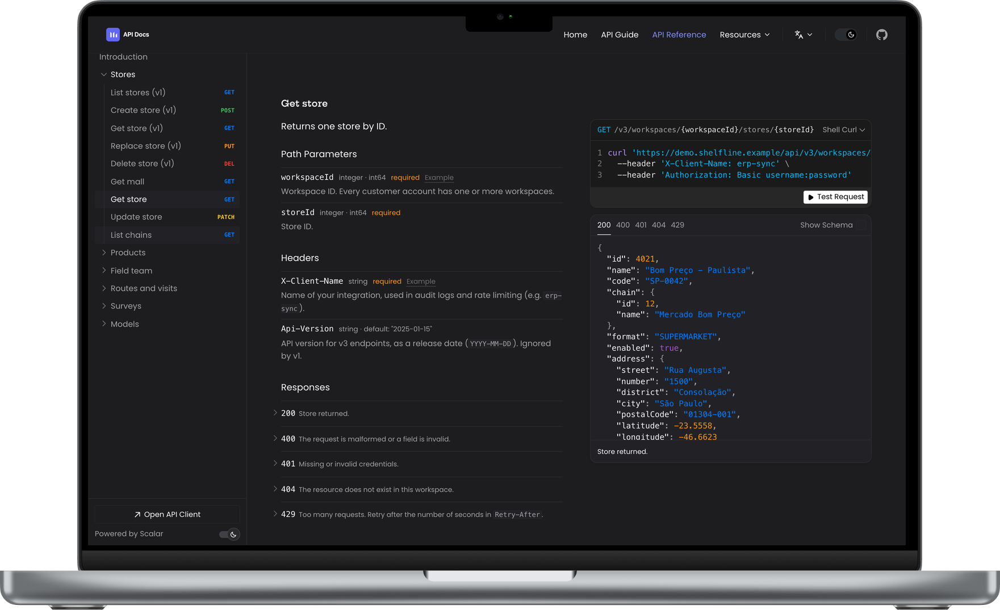

# API Docs Starter

[](LICENSE)
[](https://api-docs-starter.rafactx.workers.dev)

A multilingual API documentation portal built with VitePress, Vue 3 and [Scalar](https://scalar.com/). Guides and an interactive API reference in English, Portuguese, Spanish and French, with the reference switching to the spec for the page's language.

**Live demo:** <https://api-docs-starter.rafactx.workers.dev>

> Também disponível em português: [README.pt-br.md](README.pt-br.md)



## Why this exists

I built this while I was a Support Engineer at Involves, where I documented a real SaaS API for customers in several countries. The stock tools gave us either nice guides or a nice API reference, never both in one place, and none of them handled one translated spec per language. This repository is that portal, rebuilt as a reusable starter.

The company's API is **not** included. The demo documents **Shelfline Field API**, a fictional retail field-execution API (stores, products, field reps, visits, surveys). Its four localized specs are generated by [openapi-fixer](https://github.com/rafactx/openapi-fixer-v2), the companion pipeline that turns a raw generated spec into a valid, translated one.

## Quickstart

Requires Node.js 18+ and pnpm.

```bash
git clone https://github.com/rafactx/api-docs-starter.git
cd api-docs-starter
pnpm install
pnpm dev        # http://localhost:5173
pnpm build      # static site in docs/.vitepress/dist
pnpm preview    # serve the build locally
```

If your pnpm version differs from the one pinned in `package.json`, run it through npx: `npx -y pnpm@8.15.5 install`.

## How it works

```text
openapi-fixer (separate repo)                 this repo
raw spec ──► hydrate ► fix ► validate ──► docs/public/openapi.<locale>.json ──► ScalarApi.vue ──► /<lang>/api-reference
                                          docs/<lang>/*.md ─────────────────► VitePress guides
```

- **Guides** are Markdown in `docs/{en,pt,es,fr}/`. Each locale has its own nav and sidebar in `docs/.vitepress/config.ts`.
- **API reference**: `docs/.vitepress/components/ScalarApi.vue` embeds Scalar and picks the spec from the page language (`en` → `openapi.en.json`, `pt` → `openapi.pt-BR.json`, ...). Pass `spec-url` to override.
- **Theme**: Scalar runs with `theme: 'none'` and its CSS variables are mapped onto VitePress's, so the reference follows the site's colors, fonts and dark mode. The palette lives in `docs/.vitepress/theme/theme.css`.
- **Components**: `ApiCard` (key/description tables used in the guides), `HeroSection` + `SpotlightBackground` (landing page), Vercel Analytics.
- **Language routing**: `docs/index.md` redirects to the browser's language; `/` redirects to `/en` (`docs/public/_redirects`).

## Project structure

```text
docs/
├── .vitepress/
│   ├── components/      ApiCard, HeroSection, ScalarApi, SpotlightBackground, Layout
│   ├── theme/           theme.css (palette), style.css, sidebar.css, fonts.css
│   └── config.ts        locales, nav, sidebars
├── public/
│   ├── openapi.{en,pt-BR,es,fr}.json   one spec per language
│   ├── preview.png                     hero image
│   └── logo-{light,dark}.svg
├── en/ pt/ es/ fr/      intro, authentication, rate-limits, examples, pagination, errors, api-reference
└── index.md             language redirect
```

## Use it for your own API

1. Replace `docs/public/openapi.*.json` with your specs (one per language, or point every locale at the same file in `SPEC_BY_LANG` inside `ScalarApi.vue`).
2. Rewrite the guide pages in `docs/<lang>/` and adjust the sidebars in `docs/.vitepress/config.ts`.
3. Change the brand block in `docs/.vitepress/theme/theme.css` and the logos in `docs/public/`.
4. Take a new `docs/public/preview.png` (the hero shows it inside a MacBook frame: screenshot at 1440×932 and composite it into the screen area).
5. Deploy: any static host works. The live demo runs on Cloudflare Workers Static Assets: `pnpm build && npx wrangler deploy` (config in `wrangler.jsonc`).

## Screenshots

- `docs/public/preview.png`: English API reference (included)
- To add: `docs/screenshots/guide-pt.png` (a Portuguese guide page) and `docs/screenshots/language-switch.gif` (switching language on the API reference)

## License

[MIT](LICENSE) © 2025 Rafael Teixeira
