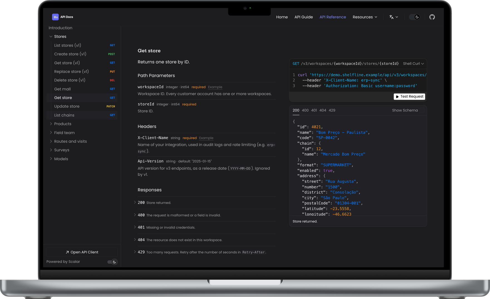

# API Docs Starter

[](https://github.com/rafactx/api-docs-starter/actions/workflows/ci.yml)
[](LICENSE)
[](https://api-docs-starter.rafactx.workers.dev)

Um portal de documentação de API multilíngue feito com VitePress, Vue 3 e [Scalar](https://scalar.com/). Guias e uma referência de API interativa em inglês, português, espanhol e francês, com a referência trocando para a spec do idioma da página.

**Demo:** <https://api-docs-starter.rafactx.workers.dev>

> Also available in English: [README.md](README.md)



## Por que existe

Criei este projeto quando era Support Engineer na Involves, onde documentei uma API SaaS real para clientes em vários países. As ferramentas prontas entregavam bons guias ou uma boa referência de API, nunca os dois no mesmo lugar, e nenhuma lidava com uma spec traduzida por idioma. Este repositório é esse portal, reconstruído como um starter reutilizável.

A API da empresa **não** está incluída. A demo documenta a **Shelfline Field API**, uma API fictícia de execução no varejo (lojas, produtos, promotores, visitas, pesquisas). As quatro specs localizadas são geradas pelo [openapi-fixer](https://github.com/rafactx/openapi-fixer), o pipeline que transforma uma spec gerada crua em uma spec válida e traduzida.

## Início rápido

Requer Node.js 22+ e pnpm 10 (`corepack enable` usa a versão fixada no `package.json`).

```bash
git clone https://github.com/rafactx/api-docs-starter.git
cd api-docs-starter
pnpm install
pnpm dev        # http://localhost:5173
pnpm typecheck  # vue-tsc
pnpm build      # site estático em docs/.vitepress/dist
pnpm preview    # serve o build localmente
```

O CI roda `pnpm typecheck` e `pnpm build` em todo pull request; o build também falha com links quebrados. Não há suíte de testes automatizados, então mudanças de interface são conferidas manualmente (veja o [CONTRIBUTING.md](CONTRIBUTING.md)).

## Como funciona

```text
openapi-fixer (outro repo)                    este repo
spec crua ──► hydrate ► fix ► validate ──► docs/public/openapi.<locale>.json ──► ScalarApi.vue ──► /<lang>/api-reference
                                           docs/<lang>/*.md ─────────────────► guias VitePress
```

- **Guias** são Markdown em `docs/{en,pt,es,fr}/`. Cada idioma tem nav e sidebar próprios em `docs/.vitepress/config.ts`.
- **Referência da API**: `docs/.vitepress/components/ScalarApi.vue` embute o Scalar e escolhe a spec pelo idioma da página (`pt` → `openapi.pt-BR.json`, `en` → `openapi.en.json`, ...). Use `spec-url` para sobrescrever.
- **Tema**: o Scalar roda com `theme: 'none'` e suas variáveis CSS são mapeadas para as do VitePress, então a referência segue cores, fontes e modo escuro do site. A paleta fica em `docs/.vitepress/theme/theme.css`.
- **Componentes**: `ApiCard` (tabelas chave/descrição dos guias), `HeroSection` + `SpotlightBackground` (página inicial).
- **Idioma**: `/` (`docs/index.md`) leva o navegador para `/pt/`, `/es/` ou `/fr/` conforme o idioma dele, e para `/en/` nos demais casos. Sem JavaScript, mostra a lista dos quatro idiomas.

## Estrutura do projeto

```text
docs/
├── .vitepress/
│   ├── components/      ApiCard, HeroSection, ScalarApi, SpotlightBackground
│   ├── theme/           theme.css (paleta), style.css, api-docs-responsive.css, sidebar.css, fonts.css
│   └── config.ts        idiomas, nav, sidebars
├── public/
│   ├── openapi.{en,pt-BR,es,fr}.json   uma spec por idioma
│   ├── preview.png                     imagem da página inicial (também usada acima)
│   └── favicon.svg, logo-{light,dark}.svg
├── en/ pt/ es/ fr/      intro, authentication, rate-limits, examples, pagination, errors, api-reference
└── index.md             redirecionamento de idioma
```

## Usando com a sua API

1. Substitua `docs/public/openapi.*.json` pelas suas specs (uma por idioma, ou aponte todos os idiomas para o mesmo arquivo em `SPEC_BY_LANG`, dentro de `ScalarApi.vue`).
2. Reescreva os guias em `docs/<lang>/` e ajuste as sidebars em `docs/.vitepress/config.ts`.
3. Troque o bloco de marca em `docs/.vitepress/theme/theme.css` e os logos em `docs/public/`.
4. Gere um novo `docs/public/preview.png` (a página inicial mostra a imagem dentro de um MacBook: print em 1440×932 composto na área da tela).
5. Publique em qualquer host estático. A demo roda no Cloudflare Workers Static Assets: `pnpm run deploy` gera o site e roda `wrangler deploy` (configuração em `wrangler.jsonc`).

## Contribuindo

Issues e pull requests são bem-vindos. Veja o [CONTRIBUTING.md](CONTRIBUTING.md) (em inglês) para setup, os checks que o CI roda e o fluxo de PR. Problemas de segurança devem ser reportados de forma privada, como descrito no [SECURITY.md](SECURITY.md).

## Licença

[MIT](LICENSE) © 2025 Rafael Teixeira
